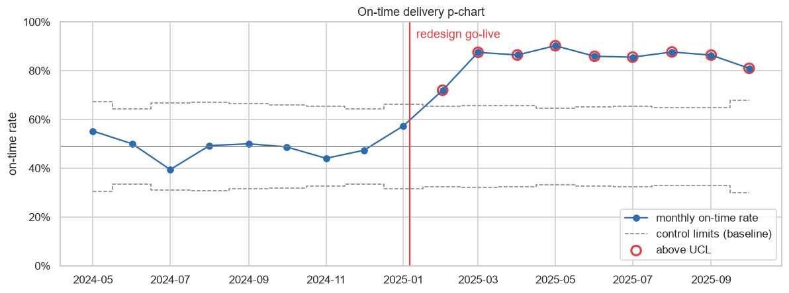
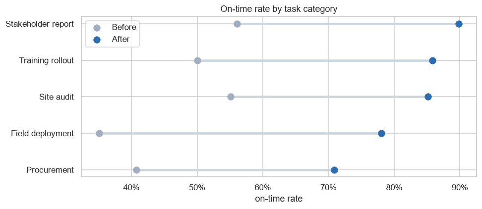
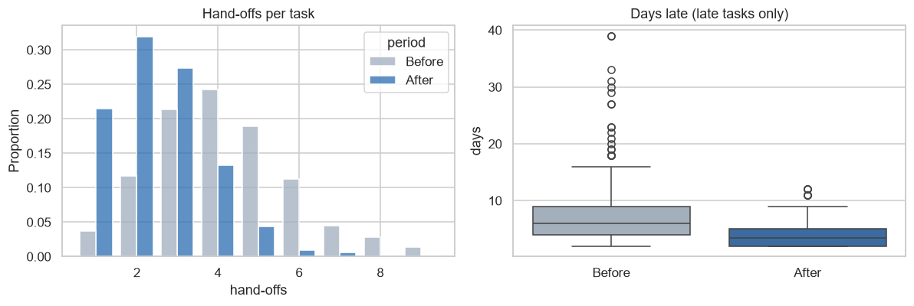

# Did the Process Redesign Work? Project Delivery KPI Analysis

A before/after analysis of **1,450 project tasks** delivered by a four-person coordination team. It tests whether a January 2025 process redesign (standard plans, fewer hand-offs, a weekly status rhythm) really improved on-time delivery.

**Tools:** Python · pandas · SciPy (chi-square, Mann-Whitney, Spearman) · statistical process control (p-chart) · seaborn

> 📓 **[Open the notebook](delivery_kpi_analysis.ipynb)**: it has been run end-to-end and all outputs are visible.

---

## Why this project
"We improved delivery by X%" is easy to say and hard to prove. This notebook shows how I'd back that claim up for a leadership team. It defines the KPIs, tests whether the change is statistically real, checks that it lasted, and shows where performance is still weak.

## KPIs defined
| KPI | Definition |
|---|---|
| On-time rate | completed on/before due date ÷ all tasks |
| Avg days late | mean days past due, late tasks only |
| Schedule variance | (actual − planned) ÷ planned |
| Rework rate | tasks reopened ÷ all tasks |
| Hand-offs per task | owner changes during the task |

## Results
| | Before | After |
|---|---|---|
| On-time rate | **48.0%** | **82.7%** |
| Change | | **+34.7 pts (+72% relative)**, 95% CI 30.1–39.4 pts |
| Median days late (late tasks) | 6 | 4 |
| Hand-offs per task | 4.2 | 2.5 |
| Rework rate | 18% | 9% |

- **Chi-square p ≈ 3 × 10⁻⁴⁴.** The improvement is not noise.
- **p-chart:** every month after the adoption ramp sits **above the baseline upper control limit**, so the process shifted and stayed shifted.
- **Hand-offs per task fell ~40%** (4.2 → 2.5) and **rework halved** (18% → 9%). More hand-offs go with lower on-time delivery (Spearman r = −0.21).
- **Still weakest:** Procurement and Field deployment, where supplier lead times and logistics sit partly outside the team's control.





**Limitations:** this is an observational before/after comparison, not a randomised experiment, so seasonality or staffing changes could contribute.

## Run it yourself
```bash
pip install -r requirements.txt
python src/generate_data.py
python build_notebook.py
```

## About the data
The project is modelled on a process-optimisation programme I led as Lead Project Coordinator. That programme improved delivery efficiency by about 75% across a team serving 100+ staff. Internal data is confidential, so **the task log here is synthetic** and generated to reflect that kind of change.
